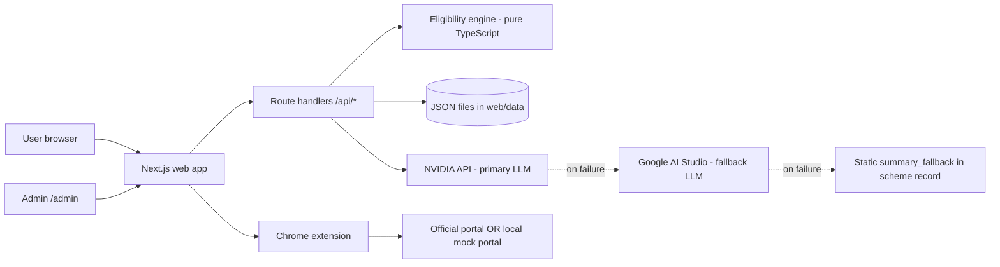
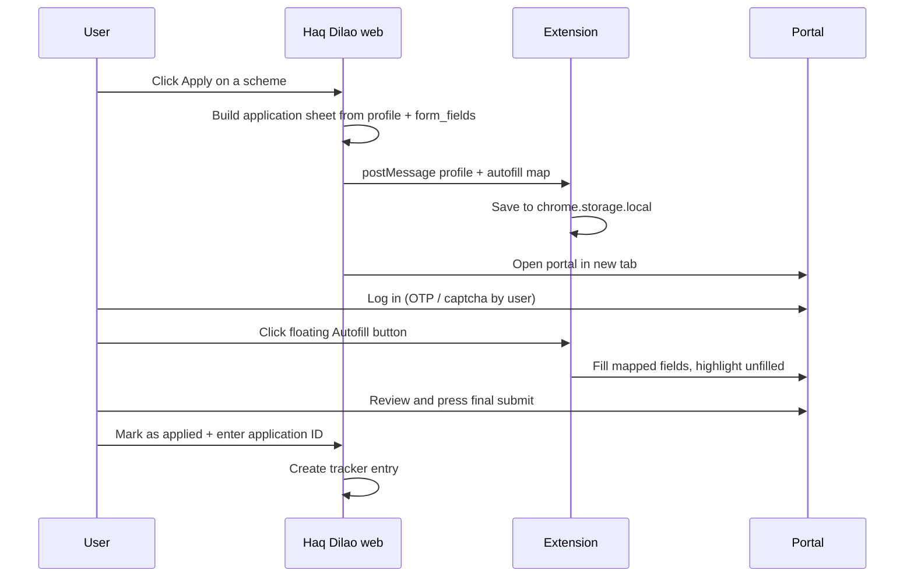

# Architecture

## System diagram

## Apply flow

## Components
| Component | Responsibility |
|---|---|
| `web/` Next.js (App Router, TypeScript, Tailwind) | UI, auth, API routes, all logic |
| `web/lib/eligibility.ts` | Pure functions: rule evaluation, status, apply score. No I/O, no LLM |
| `web/lib/store.ts` | Only file that reads/writes JSON files (atomic writes). Swappable later |
| `web/lib/llm.ts` | NVIDIA -> Gemini -> static fallback, with caching |
| `web/lib/dates.ts` | Date logic in Asia/Kolkata, date-only comparisons |
| `web/lib/notify.ts` | Create notifications with dedupe keys; reminder check |
| `web/data/*.json` | users, schemes, applications, notifications, summary-cache |
| `extension/` | MV3 content scripts: receive profile, autofill portal form |

## Design decisions
- JSON file store, not a database: zero setup, works offline, demo runs locally. (Vercel's filesystem is read-only, so the deployed version would need Upstash Redis or Turso; this is a post-hackathon step, not part of the build.)
- Eligibility deterministic so the app never tells someone they qualify by accident.
- No cron: reminders run on dashboard load and via an admin "Run reminder check" button.
- Every external call (LLM) has a fallback so the demo cannot break.
